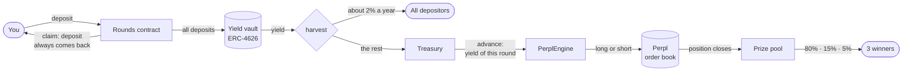
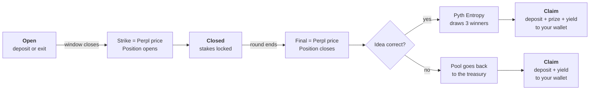

# Rounds

**Save in dollars. Pick a side on BTC. Your deposit always comes back.**

Rounds runs short rounds on Monad. Your deposit earns yield. The yield of the round trades your idea on Perpl, an on-chain order book. If the idea is correct, three depositors share the prize. If it is wrong, you lose nothing: you get your deposit back, plus base yield.

> Live app: [saverounds.vercel.app](https://saverounds.vercel.app/) · Network: Monad testnet (chain 10143) · Demo video: _add link_

---

## The idea in 30 seconds

1. **You deposit dollars** into a round, for example "BTC goes up in the next 24 hours".
2. **The round trades only the yield.** It never trades your deposit.
3. **When the round ends,** you get your deposit back. If the idea was correct, three depositors also win the prize: 80%, 15% and 5%.

A larger deposit gives a larger chance to win. Nobody can lose the deposit.

---

## Where the money goes



In plain words:

- **Deposits stay in the vault.** They earn yield all the time.
- **Everyone gets base yield,** about 2% a year. Nobody needs to win for this.
- **The treasury pays the round in advance.** When the entry window closes, the treasury gives the round the yield that the stakes will earn during the round. The round does not wait. The yield that comes in later pays the treasury back.
- **Only this advance trades.** The engine opens one position on Perpl with it. The maximum loss is this advance.
- **The prize earns yield too.** A winner gets the prize at the draw. The prize earns base yield until the winner claims it.

---

## Life of a round



| Phase | What you can do | What happens |
|---|---|---|
| **Open** | Deposit, add more, exit | Nothing trades yet |
| **Closed** | Wait | The strike is fixed. The position on Perpl is open. Your stake is locked. |
| **Drawing** | Wait (about 2 blocks) | Pyth Entropy sends a random number. The contract picks 3 winners. |
| **Settled** | Claim | One click sends your deposit, prize and yield to your wallet |

---

## An example

You put **100 USD** into "Bullish BTC, 15x". The round has a pool of **20 USD**.

| What happens | You get back |
|---|---|
| BTC goes down. The idea is wrong. | 100 USD + base yield |
| BTC goes up. The idea is correct, but you are not drawn. | 100 USD + base yield |
| BTC goes up 2%. The 15x position makes +30%. The pool grows to 26 USD. A 3% fee comes off the 6 USD profit, so the pool is 25.82 USD. You are drawn 1st and get 80% of it. | 100 USD + about 20.66 USD + base yield |

Your chance to be drawn is your stake divided by all stakes in the round.

---

## Why Monad

- **The contract trades on an on-chain order book.** One transaction fixes the strike and places a real order on Perpl. This needs a fast chain with a fully on-chain order book.
- **Short rounds are cheap.** A 10-minute round costs a few transactions. Blocks are about 0.4 s.
- **A new round is a function call.** All rounds live in one contract. Mirror pairs (Bullish and Bearish on the same blocks) show as one card.
- **I like monad ecosystem**.


---

## You do not need to trust us

- **The price is read on-chain.** `setStrike` and `settle` read the Perpl mark price inside the contract. Nobody types a price.
- **Anyone can call them, but only in a short window** (150 blocks, about 45 s) after the phase ends. A caller cannot pick a better moment.
- **The draw uses Pyth Entropy,** a verifiable random number. A retry is owner-only, so nobody can cancel a result they do not like.
- **User deposits never go to the engine.** Only the round budget does. The contract keeps this rule.
- **37 tests pass.** 9 of them are fork tests against the real Perpl exchange on Monad testnet.

---

## Contracts on Monad testnet

| Contract | Address | Job |
|---|---|---|
| `Rounds` | [`0xF265…5bd0`](https://testnet.monadscan.com/address/0xF265552D95De56AecdC1711966f2C17f89965bd0) | Rounds, deposits, yield split, draw, claim |
| `PerplEngine` | [`0x2c44…ec9F`](https://testnet.monadscan.com/address/0x2c44282C73d17c82d199457a52De1Ffe4ED4ec9F) | Opens and closes one Perpl position per round |
| `PerplPriceSource` | [`0xcF23…23D3`](https://testnet.monadscan.com/address/0xcF23CC9d662d1d623546BA3AB2A8fE07231723D3) | Reads the Perpl mark price |
| `MockYieldVault` | [`0xF731…BfBc0`](https://testnet.monadscan.com/address/0xF73182502D01fF6E564bF683FB2e7f7D180BfBc0) | ERC-4626 vault with fixed APR (testnet only) |
| AUSD (collateral) | [`0xa901…22dC`](https://testnet.monadscan.com/address/0xa9012a055bd4e0eDfF8Ce09f960291C09D5322dC) | Dollar stablecoin by Agora, shown as USD |
| Pyth Entropy | [`0x825c…3c07`](https://testnet.monadscan.com/address/0x825c0390f379C631f3Cf11A82a37D20BddF93c07) | Random numbers |
| Perpl Exchange | [`0x1964…80cc`](https://testnet.monadscan.com/address/0x1964C32f0bE608E7D29302AFF5E61268E72080cc) | On-chain perpetuals order book |

Leverage caps per market: BTC 15x, ETH 12x, SOL 10x, MON 3x. Each round sets its own leverage up to the cap.

---

## Run it

**Contracts** (Foundry):

```bash
cd contracts
forge test                                   # 28 unit tests
set -a; . ../.env; set +a; forge test        # + 9 fork tests on real Perpl (needs MONAD_TESTNET_RPC)
```

`foundry.toml` points `solc` to a local binary. If you do not have `/opt/homebrew/bin/solc`, set `solc = "0.8.36"`.

**Keeper** (calls `setStrike` and `settle` at the right block; it decides nothing):

```bash
./scripts/keeper.sh                          # needs MONAD_TESTNET_RPC, PRIVATE_KEY, ROUNDS in .env
```

**Web app** (Next.js, wagmi, Privy):

```bash
cd web
npm install
cp .env.local.example .env.local             # Privy app id and contract addresses
npm run dev
```

---

## Repository map

```
contracts/src/Rounds.sol            rounds, vault accounting, draw, claim
contracts/src/PerplEngine.sol       Perpl adapter (one position per round)
contracts/src/PerplPriceSource.sol  on-chain price for strike and settle
contracts/src/MockYieldVault.sol    ERC-4626 stand-in for a Morpho vault
contracts/test/                     unit tests and Perpl fork tests
scripts/keeper.sh                   keeper bot
web/                                Next.js app
```

---

## Status and limits

- **Testnet only.** The yield vault is a mock with a fixed APR, paid from a reserve that we fund. On mainnet, a Morpho AUSD vault replaces it with no code change (both are ERC-4626).
- **Perps are linear.** Higher leverage gives larger and rarer prizes, not a larger average. Options or outcome tokens can add convexity later.
- **Mirror pairs:** the engine holds one position per market, so only one side of a pair trades.
- **A random draw has legal risk** in some countries. In mirror pairs each user picks a side, which makes the product closer to a derivative.

## Next

1. Mainnet with a Morpho AUSD vault.
2. Risk levels per vault: Steady (3x) and Moonshot (15x).
3. A jackpot that grows from lost rounds.
4. The engine as a module for wallets and exchanges.
5. Robinhood Chain for stock rounds (NVDA, TSLA).
