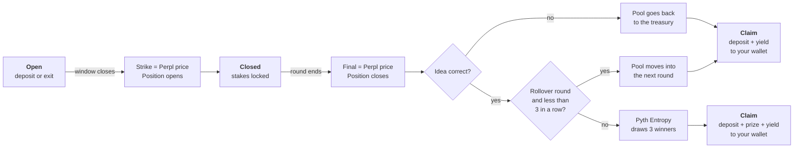

# Rounds

**Wrong call? Every dollar back.**

Rounds is a no-loss up/down market on Monad. You pick up or down on BTC. Every round has a prize pool, paid by Rounds today (on mainnet: the interest on all deposits). Only the pool trades, as a real position on Perpl, an on-chain order book. Right call: three players split the pool. Wrong call: you get your whole deposit back.

**Who pays the prize?** Today Rounds pays it as a launch budget. On mainnet, the interest on all deposits pays it.

> Live app: [saverounds.vercel.app](https://saverounds.vercel.app/) · Network: Monad testnet (chain 10143) · Demo video: _add link_

---

## The idea in 30 seconds

1. **You deposit dollars** into a round, for example "BTC goes up in the next 24 hours".
2. **Only the round's prize pool trades.** Your deposit never trades.
3. **When the round ends,** you get your deposit back. If the idea was correct, three depositors also win the prize: 80%, 15% and 5%.

A larger deposit gives a larger chance to win. Nobody can lose the deposit.

---

## Where the money goes


In plain words:

- **Deposits stay in the vault.** They earn yield all the time.
- **Everyone gets base yield,** about 2% a year. Nobody needs to win for this.
- **The treasury pays the round in advance.** When the entry window closes, the treasury gives the round the yield that the stakes will earn during the round. The round does not wait. The yield that comes in later pays the treasury back.
- **Only this advance trades.** The engine opens one position on Perpl with it. The maximum loss is this advance.
- **The prize earns yield too.** A winner gets the prize at the draw. The prize earns base yield until the winner claims it.

---

## Life of a round



| Phase | What you can do | What happens |
|---|---|---|
| **Open** | Deposit, add more, exit | Nothing trades yet |
| **Closed** | Wait | The strike is fixed. The position on Perpl is open. Your stake is locked. |
| **Drawing** | Wait (about 2 blocks) | Pyth Entropy sends a random number. The contract picks 3 winners. |
| **Settled** | Claim | One click sends your deposit, prize and yield to your wallet |

### Kinds of rounds (live now)

| Round | How it works |
|---|---|
| **Quick rounds** | Every hour, 15 minutes. SOL (rollover) and ZEC. |
| **Rollover** | A won pool is not drawn. It moves into the next round of the series and trades again on Perpl. The third win in a row draws the big pool. A loss sends the pool back to the treasury. |
| **Bulls vs Bears pairs** | BTC every 6 hours. Two rounds on the same blocks, one per side. |
| **Round of the day** | ETH, always ends at 18:00 UTC. |
| **Jackpot of the week** | ETH, Sunday 20:00 UTC. 100 USD, +50 USD after every week nobody wins (up to 500). |

Each series is a few lines in `scripts/series.json`. The rollover link is on-chain: `linkRide(id, next)`, at most `maxRideLegs` (3) pools in a row.

---

## An example

You put **100 USD** into "Bullish BTC, 15x". The round has a pool of **20 USD**.

| What happens | You get back |
|---|---|
| BTC goes down. The idea is wrong. | 100 USD + base yield |
| BTC goes up. The idea is correct, but you are not drawn. | 100 USD + base yield |
| BTC goes up 2%. The 15x position makes +30%. The pool grows to 26 USD. A 3% fee comes off the 6 USD profit, so the pool is 25.82 USD. You are drawn 1st and get 80% of it. | 100 USD + about 20.66 USD + base yield |

Your chance to be drawn is your stake divided by all stakes in the round.

---

## Why Monad

- **The contract trades on an on-chain order book.** One transaction fixes the strike and places a real order on Perpl. This needs a fast chain with a fully on-chain order book.
- **Short rounds are cheap.** A 10-minute round costs a few transactions. Blocks are about 0.4 s.
- **A new round is a function call.** All rounds live in one contract. Mirror pairs (Bullish and Bearish on the same blocks) show as one card.
- **I like monad ecosystem**.


---

## You do not need to trust us

- **The price is read on-chain.** `setStrike` and `settle` read the Perpl mark price inside the contract. Nobody types a price.
- **Anyone can call them, but only in a short window** (150 blocks, about 45 s) after the phase ends. A caller cannot pick a better moment.
- **The draw uses Pyth Entropy,** a verifiable random number. A retry is owner-only, so nobody can cancel a result they do not like.
- **User deposits never go to the engine.** Only the round budget does. The contract keeps this rule.
- **51 tests pass.** 9 of them are fork tests against the real Perpl exchange on Monad testnet.

---

## Embed a round in any wallet

Wallets, exchanges and neobanks can add "play the market, keep your money" to their app. One round is one iframe. `live` always shows the current open round, so the link never goes stale.

```tsx
export function RoundCard({ asset = "BTC" }) {
  return (
    <iframe
      src={`https://saverounds.vercel.app/embed/live?asset=${asset}`}
      width={360}
      height={760}
      style={{ border: 0, borderRadius: 16 }}
      title="Rounds"
    />
  );
}
```

- `/embed/live` · `/embed/live?asset=BTC` · `/embed/<round id>`
- Live demo inside a wallet: [saverounds.vercel.app/embed](https://saverounds.vercel.app/embed)
- Next step: an SDK that uses the host wallet directly, without a second login.

---

## Contracts on Monad testnet

All our contracts are **verified on MonadScan**: click an address to read the source code, or call functions with Read/Write Contract.

| Contract | Address | Job |
|---|---|---|
| `Rounds` | [`0xA046…715a`](https://testnet.monadscan.com/address/0xA04679b2A4f457d6056bd1a8Cf375618eF90715a#code) | Rounds, deposits, yield split, draw, claim |
| `SplitEngine` | [`0xE0e1…Ad53`](https://testnet.monadscan.com/address/0xE0e1485Be0A529D138087818c49441cc35F2Ad53#code) | Engine router: longs to one Perpl account, shorts to another, so both sides of a pair trade |
| `PerplEngine` (longs) | [`0xD5d7…bA86`](https://testnet.monadscan.com/address/0xD5d7232bDe5744A3afE276b22d83253E9db4bA86#code) | Opens and closes the long positions on Perpl |
| `PerplEngine` (shorts) | [`0x8681…Aded`](https://testnet.monadscan.com/address/0x86819A1B757735B3EEC8A9536e71C882b40BAded#code) | Opens and closes the short positions on Perpl |
| `PerplPriceSource` | [`0xcF23…23D3`](https://testnet.monadscan.com/address/0xcF23CC9d662d1d623546BA3AB2A8fE07231723D3#code) | Reads the Perpl mark price |
| `Faucet` | [`0xbCF1…7e19`](https://testnet.monadscan.com/address/0xbCF1beF801CC4A9c948A464410DB210Fe2d07e19#code) | Test USD and a little MON for new players; our relayer pays the gas |
| `MockYieldVault` | [`0xF731…BfBc0`](https://testnet.monadscan.com/address/0xF73182502D01fF6E564bF683FB2e7f7D180BfBc0#code) | ERC-4626 vault with fixed APR (testnet only) |
| AUSD (collateral) | [`0xa901…22dC`](https://testnet.monadscan.com/address/0xa9012a055bd4e0eDfF8Ce09f960291C09D5322dC) | Dollar stablecoin by Agora, shown as USD |
| Pyth Entropy | [`0x825c…3c07`](https://testnet.monadscan.com/address/0x825c0390f379C631f3Cf11A82a37D20BddF93c07) | Random numbers |
| Perpl Exchange | [`0x1964…80cc`](https://testnet.monadscan.com/address/0x1964C32f0bE608E7D29302AFF5E61268E72080cc) | On-chain perpetuals order book |

The first `Rounds` contract ([`0xF265…5bd0`](https://testnet.monadscan.com/address/0xF265552D95De56AecdC1711966f2C17f89965bd0#code), before rollover) only finishes its last rounds. Players take their money out of it from the profile page.

Leverage caps per market: BTC 15x, ETH 12x, SOL 10x, MON 3x. Each round sets its own leverage up to the cap.

---

## Run it

**Contracts** (Foundry):

```bash
cd contracts
forge test                                   # 28 unit tests
set -a; . ../.env; set +a; forge test        # + 9 fork tests on real Perpl (needs MONAD_TESTNET_RPC)
```

`foundry.toml` points `solc` to a local binary. If you do not have `/opt/homebrew/bin/solc`, set `solc = "0.8.36"`.

**Bots: keeper and scheduler** (one light Node process, runs 24/7 on a small server as a systemd service):

```bash
cd bots && npm ci && npm start   # needs MONAD_TESTNET_RPC, ROUNDS, KEEPER_PK, PRIVATE_KEY in ../.env
DRY_RUN=1 npm start              # read the chain and log what it would send, send nothing
SCHEDULER=0 ROUNDS=0x… npm start # keeper only: finish the rounds of an old contract
```

- **Keeper:** calls `settleMany`, then `setStrikeMany`, at the right block, with a key without owner rights. If a call fails because the window passed (for example after downtime), it retries with the owner key.
- **Scheduler:** keeps one open round (or mirror pair) per series from `scripts/series.json`, and opens the next one when a window closes. It grows the weekly jackpot and links rollover rounds (`linkRide`).

The keeper decides nothing: the contract reads the price on-chain, and anyone can make these calls inside the window.

**Web app** (Next.js, wagmi, Privy):

```bash
cd web
npm install
cp .env.local.example .env.local             # Privy app id and contract addresses
npm run dev
```

---

## Repository map

```
contracts/src/Rounds.sol            rounds, vault accounting, draw, claim
contracts/src/PerplEngine.sol       Perpl adapter (one position per round)
contracts/src/SplitEngine.sol       router: longs and shorts on separate Perpl accounts
contracts/src/PerplPriceSource.sol  on-chain price for strike and settle
contracts/src/MockYieldVault.sol    ERC-4626 stand-in for Aave AUSD (static aToken wrapper)
contracts/src/Faucet.sol            testnet faucet: 100 USD + 0.3 MON per day, daily cap
contracts/test/                     unit tests and Perpl fork tests
bots/index.mjs                      keeper + scheduler (Node, viem)
scripts/series.json                 round series: asset, side, leverage, prize, timing
web/                                Next.js app (site, /season, /embed, share cards)
```

---

## Partners we are talking to

- **Perpl** (execution venue): every round trades on Perpl's on-chain order book. Rounds is a "no-loss mode" that brings new traders to it. From the Perpl team: *"I like this."* (Arich, Perpl, quoted with permission.)
- **Agora** (the AUSD issuer): Agora recommended Aave AUSD as the yield source for mainnet. Their partner model shares rewards with apps that hold AUSD float, and they offered to flag AUSD lending opportunities with a higher yield (bigger prizes for the same deposits). We will only use venues that keep the "every dollar back" promise.
- **Next yield sources:** tokenized stocks that now pay their holders (xStocks): a holder keeps the stock, and only its payouts play in a round.

## Status and limits

- **Testnet only.** The yield vault is a mock with a fixed APR, paid from a reserve that we fund. On mainnet, Aave AUSD replaces it through Aave's ERC-4626 wrapper, with no change to `Rounds`. Agora, the AUSD issuer, recommended Aave for instant withdrawals.
- **Perps are linear.** Higher leverage gives larger and rarer prizes, not a larger average. Options or outcome tokens can add convexity later.
- **One position per market and side:** Perpl nets positions per account, so each engine (longs, shorts) holds one position per market. Two rounds on the same market and side at the same time: the second one plays for a fixed prize.
- **A random draw has legal risk** in some countries. In mirror pairs each user picks a side, which makes the product closer to a derivative.

## Next

The full table with the prize multiples is in [docs/submission.md](docs/submission.md#next). In short:

1. **More kinds of rounds, same contract:** Turbo on Perpl (convex payoff), stock and pre-IPO perps (NVDA, TSLA, SpaceX), event rounds on prediction markets, new-token baskets on Kuru or nad.fun, options.
2. **Mainnet** with Aave AUSD as the yield source (recommended by Agora), deposit with any token or a card.
3. **"Play again" by default:** the money stays in the series until the user takes it out.
4. **The engine as a module** for wallets and exchanges, and an SDK without a second login.
5. **Robinhood Chain** for stock rounds.
