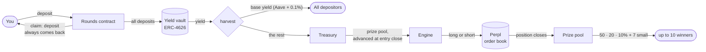
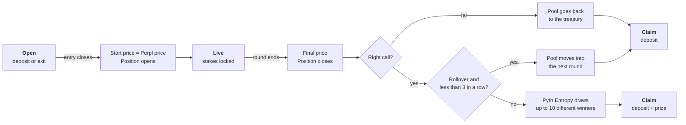

# Rounds

**Wrong call? Every dollar back.**

Rounds is a no-loss up/down market on Monad. You call crypto up or down. Every round has a prize pool, and only the pool trades, as a real position on Perpl, an on-chain order book. Right call: up to 10 players share the pool. Wrong call: you get your whole deposit back. Today Rounds pays the pool as a launch budget; on mainnet the interest on all deposits pays it.

> Live app: [saverounds.vercel.app](https://saverounds.vercel.app/) · Network: Monad testnet (chain 10143) · Demo video: _add link_ · Economics, yield scenarios and partners: [docs/submission.md](docs/submission.md)

---

## Where the money goes



- **Deposits stay in the vault** and never go to the engine. The maximum loss is the prize pool.
- **Everyone gets a fixed base yield** (`baseAprBps`, today Aave + 0.1% ≈ 5.94% a year), never more than the vault earns.
- **The treasury advances the prize pool** when entry closes; the yield that comes in later pays it back.
- **Prizes earn base yield** from the draw until the winner claims.

## Life of a round



Live series (each is a few lines in `scripts/series.json`): hourly SOL with rollover and ZEC, a BTC up/down pair every 6 hours, an ETH Round of the day, a daily MON round, a weekly ETH jackpot that grows after every week nobody wins.

**Example.** 100 USD on "BTC goes up?" at 15x, a 20 USD pool. BTC falls: you get 100 USD back. BTC rises 2%: the position makes +30%, the pool is 25.82 USD after the 3% fee on profit, and if you are drawn 1st you get 100 USD + 12.91 USD. Your chance is your stake divided by all stakes.

## Why Monad

- **Every round is its own trade on an on-chain order book.** One transaction fixes the start price and opens the position in the same block.
- **Short rounds are cheap:** a 15-minute round costs a few transactions (0.4 s blocks).
- **A new round is a function call.** All rounds live in one contract.
- **I like monad ecosystem**.

## You do not need to trust us

- **The price is read on-chain.** `setStrike` and `settle` read the Perpl mark price inside the contract.
- **Anyone can call them, but only in a 150-block window,** so nobody can pick a better moment.
- **The draw uses Pyth Entropy.** A retry is owner-only, so nobody can cancel a result.
- **A stop-loss guard** in the keeper closes a position at 70% loss of its margin, before Perpl liquidates it (`STOP_LOSS` in `bots/index.mjs`).
- **55 tests pass,** 9 of them fork tests against the real Perpl exchange.

## Embed a round in any wallet

```tsx
export function RoundCard({ asset = "BTC" }) {
  return (
    <iframe
      src={`https://saverounds.vercel.app/embed/live?asset=${asset}`}
      width={360}
      height={760}
      style={{ border: 0, borderRadius: 16 }}
      title="Rounds"
    />
  );
}
```

`/embed/live` · `/embed/live?asset=BTC` · `/embed/<round id>` · demo: [saverounds.vercel.app/embed](https://saverounds.vercel.app/embed)

## Contracts on Monad testnet

All contracts are verified on MonadScan.

| Contract | Address | Job |
|---|---|---|
| `Rounds` | [`0x030b…62ad`](https://testnet.monadscan.com/address/0x030b1D29A5f99f99efD4bcDFbEE78d6C19e162ad#code) | Rounds, deposits, base yield, draw, claim |
| `SplitEngine` | [`0x6990…87A3`](https://testnet.monadscan.com/address/0x69904dDEC56Fcfe2A87a77b2e1ae4547611A87A3#code) | Router: longs and shorts on separate Perpl accounts, so both sides of a pair trade |
| `PerplEngine` (longs) | [`0xD2dB…cD7b`](https://testnet.monadscan.com/address/0xD2dBCbF1BF3F2acE53726e7077825C7F6810cD7b#code) | Opens and closes long positions |
| `PerplEngine` (shorts) | [`0xd58F…DD8e`](https://testnet.monadscan.com/address/0xd58F556534eAdF858CFAaf9Af80cC552eE85DD8e#code) | Opens and closes short positions |
| `PerplPriceSource` | [`0xcF23…23D3`](https://testnet.monadscan.com/address/0xcF23CC9d662d1d623546BA3AB2A8fE07231723D3#code) | Reads the Perpl mark price |
| `Faucet` | [`0xbCF1…7e19`](https://testnet.monadscan.com/address/0xbCF1beF801CC4A9c948A464410DB210Fe2d07e19#code) | Test USD and a little MON for new players |
| `MockYieldVault` | [`0xF731…BfBc0`](https://testnet.monadscan.com/address/0xF73182502D01fF6E564bF683FB2e7f7D180BfBc0#code) | Testnet vault, 7.5% (the rate of the best AUSD vaults on mainnet) |
| AUSD | [`0xa901…22dC`](https://testnet.monadscan.com/address/0xa9012a055bd4e0eDfF8Ce09f960291C09D5322dC) | Agora's dollar stablecoin |
| Pyth Entropy | [`0x825c…3c07`](https://testnet.monadscan.com/address/0x825c0390f379C631f3Cf11A82a37D20BddF93c07) | Random numbers |
| Perpl Exchange | [`0x1964…80cc`](https://testnet.monadscan.com/address/0x1964C32f0bE608E7D29302AFF5E61268E72080cc) | On-chain perpetuals order book |

Earlier `Rounds` contracts only finish their last rounds; players take their money out from the profile: v2 [`0xA046…715a`](https://testnet.monadscan.com/address/0xA04679b2A4f457d6056bd1a8Cf375618eF90715a#code), v1 [`0xF265…5bd0`](https://testnet.monadscan.com/address/0xF265552D95De56AecdC1711966f2C17f89965bd0#code).

Leverage caps: BTC 15x, ETH 12x, SOL 10x, ZEC 5x, MON 3x.

## Run it

```bash
cd contracts && forge test                    # 46 unit tests
set -a; . ../.env; set +a; forge test         # + 9 fork tests on real Perpl (needs MONAD_TESTNET_RPC)

cd bots && npm ci && npm start                # keeper + scheduler + stop-loss guard (../.env: MONAD_TESTNET_RPC, ROUNDS, KEEPER_PK, PRIVATE_KEY)
DRY_RUN=1 npm start                           # read and log only
SCHEDULER=0 ROUNDS=0x… npm start              # keeper only, for an old contract

cd web && npm install && cp .env.local.example .env.local && npm run dev
```

`foundry.toml` points `solc` to a local binary; without `/opt/homebrew/bin/solc`, set `solc = "0.8.36"`. The keeper decides nothing: the contract reads the price, and anyone can make its calls inside the window.

## Repository map

```
contracts/src/Rounds.sol            rounds, vault accounting, base yield, draw, claim
contracts/src/PerplEngine.sol       Perpl adapter (one position per round)
contracts/src/SplitEngine.sol       router: longs and shorts on separate Perpl accounts
contracts/src/PerplPriceSource.sol  on-chain price for strike and settle
contracts/src/MockYieldVault.sol    ERC-4626 stand-in for the mainnet AUSD vault
contracts/src/Faucet.sol            testnet faucet: 100 USD + 0.3 MON per day
bots/index.mjs                      keeper, scheduler, stop-loss guard (Node, viem)
scripts/series.json                 round series: asset, side, leverage, prize, timing
web/                                Next.js app (site, /season, /how, /embed, share cards)
```

## Limits

- **Testnet only.** The vault is a mock; on mainnet the best AUSD vaults replace it with no change to `Rounds`.
- **One position per market and side:** two rounds on the same market and side at the same time, the second plays for a fixed prize.
- **Prize draws are regulated** in some countries; each user picks a side, which makes Rounds closer to a market.
