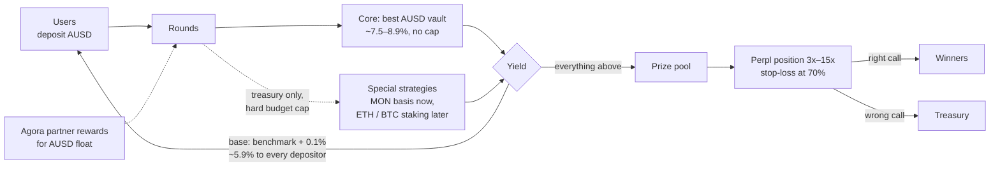

# Rounds

**A no-loss up/down market on Monad's on-chain order book.**

Wrong call? Every dollar back. Call crypto up or down; right calls share a prize we pay for.

**Short description (one line):** Rounds is a no-loss up/down market on Monad: you pick up or down on BTC, only a prize pool trades on Perpl, and your deposit always comes back.

Live app: https://saverounds.vercel.app · Code: https://github.com/kovdanielgh/rounds · Network: Monad testnet · Demo video: _add link_

**Who pays the prize?** Today Rounds pays it as a launch budget. On mainnet, the interest on all deposits pays it.

---

## Who it is for first

**A perp trader on Monad who just got liquidated** and is afraid to open the next position. They still want to make market calls, and they still want the rare big win. Today every way to act on a call puts the deposit at risk.

- **Why this market does not exist yet:** no-loss products (PoolTogether) give the deposit back, but the user cannot pick a side and nothing trades. Prediction markets and perps let you pick a side, but they take the deposit when you are wrong.
- **What Rounds gives them:** pick up or down, keep every dollar, and a chance at a random high payoff. The prize pool trades at up to 15x on Perpl, a rollover can carry it 3 rounds in a row, and half of it goes to the 1st place and the rest to nine more winners. Small, rare, big wins on top of a deposit that never trades.
- **Counterparties:** Perpl is the execution venue (a "no-loss mode" that brings it new traders), Agora's AUSD on Aave is the yield source on mainnet.

## The problem

People like to play: lottery tickets, sports bets, prediction markets. Almost always, they lose money.

Safe savings pay about 4–5% a year. Safe savings are boring.

Prize-linked savings tried to join the two. PoolTogether gives the deposit back, but its prizes are small (about 2.5% a year) and come from pure luck. Its TVL fell 97% from the peak.

## The solution

Rounds is a no-loss round on Monad.

1. **You deposit dollars and pick a side**, for example Bulls or Bears on BTC.
2. **Only the prize pool trades, your deposit does not.** On testnet Rounds pays the pool. On mainnet the pool is the interest that all deposits earn during the round: the treasury advances it when the entry window closes. The contract trades only the pool on Perpl, an on-chain order book on Monad, with up to 15x leverage.
3. **If your side is right, up to 10 different depositors win the result:** three big prizes (50%, 20%, 10%) and seven small ones (3% or 2.5% each), so more people win something. Pyth Entropy draws them, weighted by stake.
4. **Your deposit always comes back**, plus a base yield for everyone (target on mainnet: Aave + 0.1%, about 5.9% a year).

Your deposit never trades. Only the prize pool does.

## Category and alternatives

**Category:** no-loss up/down market. Closest relatives: up/down prediction markets (you pick a side) and prize-linked savings (your deposit comes back).

| What people use today | Good at | Where it falls short |
|---|---|---|
| Lottery tickets, sports bets | excitement, big prizes | the money is almost always lost |
| Polymarket, perps | excitement, control | you can lose everything |
| Lending (Morpho, Aave), savings accounts | safe | boring, about 4–5% a year |
| PoolTogether | deposit comes back | small prizes (about 2.5% a year), pure luck, no choice |
| Premium Bonds (UK) | deposit comes back, state guarantee | UK only, no crypto, no choice of side |

**Rounds:** the user picks a side, the prize trades as a real position on Perpl, and the deposit always comes back. Proof: real 3x–15x positions on Perpl testnet, verified contracts, 55 tests.

## Why only on Monad

**Every round is its own trade on an on-chain order book.** At the moment entry closes, one transaction reads the Perpl price, fixes it as the start price and opens a real position on Perpl. At the end, one transaction closes it and draws the winners. This only works when the price, the order book and the settlement live on the same fast chain:

- **0.4 s blocks and an on-chain CLOB:** the start price and the position are fixed in the same block, so nobody can trade against a stale price.
- **Cheap transactions:** a 15-minute round costs a few transactions. On Ethereum the gas would be larger than the prize.
- **The structure is new:** principal and yield are split, the user picks the side of the yield leg, and the yield leg is executed on a CLOB. Each side of an up/down pair gets its own real position (long and short on separate Perpl accounts).

## You do not need to trust us

- The contract reads the Perpl mark price on-chain. Nobody types a price.
- Anyone can call `setStrike` and `settle`, but only in a 150-block window after the phase ends. After the window, only the owner can call them.
- Pyth Entropy gives the random number for the draw.
- User deposits never go to the trading engine. The maximum loss is the round budget.
- **A stop-loss guard closes a position before Perpl liquidates it.** The keeper reads every open position every 5 seconds. At 70% loss of its margin, it closes the position through the engine. What is left goes back into the prize pool, instead of burning in a liquidation. Tested live on round #179.
- 55 Foundry tests pass, 9 of them are fork tests against the real Perpl exchange.
- All contracts are verified on MonadScan.

## What works today (Monad testnet)

- Rounds open automatically: quick SOL (rollover) and ZEC rounds every hour, a BTC Bulls vs Bears pair every 6 hours, the ETH Round of the day, a daily MON round and the weekly ETH jackpot.
- Each round opens a real 3x–15x position on Perpl when entry closes and closes it at settle.
- No crypto needed to start: log in with email, and test USD plus a little MON for gas arrive by themselves.
- One-click claim: deposit and prize go straight to the wallet.
- A live price chart with the start price, and a prize that moves with the Perpl position.
- Your call record ("7 right of 11") and a Season 0 leaderboard ranked by right calls. Share cards read the result from the contract, so nobody can fake it.

**Also live, beyond the core** (extras for later segments, not what we lead with):
- **Rollover:** in the hourly SOL series a won prize pool rolls into the next round and trades again, up to 3 in a row, then the big pool is drawn.
- **Jackpot of the week** and **Round of the day:** habits for players who come back.
- **An embeddable round for wallets:** one iframe, 10 lines of code. This is the B2B path after the first segment.

## Traction so far (Monad testnet, 11 Oct)

Counted from the contracts, team wallets excluded:

- **89 rounds** created by the bots, **67 settled** on their own. No manual pricing, no manual settles.
- **13 real positions opened on Perpl** by the contract (about 190 USD of prize pools traded, 3x–15x).
- **5 real players, 14 entries, 351 USD** deposited. **Deposits lost: 0.**
- Of the finished rounds with players, the called side was right in **8 of 14**.
- First feedback came through the in-app form after deposits. The main lesson ("looks like a scam" from a first-time user) changed the whole site copy: one promise, who pays the prize, plain words.

## Tested with real people, fixed what they hit

We watched first-time users (Hotjar recordings, an in-app feedback form, direct messages) and changed the product after each finding:

1. **"Why are there numbers in the corner?"** The header showed a wallet address. Now it shows the person's Google name or email (Privy), and the address only for wallet logins.
2. **"How does it work? Looks like scam."** The site explained the mechanism instead of the promise. We cut everything else: one headline ("Wrong call? Every dollar back."), who pays the prize, the rules in plain words, one example at the deposit button.
3. **Hotjar: people read with the mouse to understand the idea.** Too much text. Cards became one question ("BTC: up or down?"), one number (the prize) and one button.
4. **A tester on Android found a rendering bug** (stale tiles behind animated cards). Heavy effects are now off on touch screens.

From the Perpl team: *"I like this."* (Arich, Perpl team, on our post in the Perpl Discord;)

The latest answer in the feedback form: clear what happens to the money: **Yes**, come back tomorrow: **Yes**, "User-friendly interface, quite transparent in use, I like it."

## Next step and target

- **Next 2 weeks (judging):** Season 0 with traders from the Monad community, 3 tests with people who never saw the app, weekly fixes from the feedback form.
- **Mainnet beta:** Aave AUSD as the yield source, a deposit cap, and a "no-loss mode" partnership with Perpl.
- **Target for the first 60 days after mainnet:** 300 depositors, 100k AUSD in deposits, and deposits that stay after the third round as the main metric.

## Why not just lend USD on Aave or Morpho?

That is our real competitor: the same deposit, the same safety, a flat ~5.8% a year (Aave AUSD on Monad), no lock. Rounds puts deposits in the best AUSD vault (~7.5%), gives everyone a bit more than Aave, and turns the rest into prizes:

| 1,000 USD for a year | Guaranteed | Expected on top | Shape |
|---|---|---|---|
| Aave AUSD | ~58 USD | 0 | flat, no lock |
| Rounds (best AUSD vault, ~7.5%) | ~59 USD (Aave + 0.1%) | ~16 USD | everyone beats Aave a little, a few win big |

What people get instead of a flat 4%: a call on the market and a chance at a large prize. The money is locked only for the round (from 15 minutes), you can exit before entry closes, and money outside a round can be taken out anytime.

Prize size at scale, 1M USD deposited (~1.56% of yearly yield goes to prizes): a daily round ~43 USD, a weekly round ~300 USD, a monthly round ~1,300 USD, before the Perpl trade multiplies it. See the mainnet yield plan below.

## Mainnet yield plan (numbers read on Monad mainnet, 13 Oct)

| Source | Yield | How we know |
|---|---|---|
| Aave AUSD (the benchmark) | 5.84% (3.37 base + 2.47 rewards) | DefiLlama |
| Best AUSD vaults: Euler, Morpho, Upshift | 7.1–8.9% | DefiLlama |
| MON liquid staking (Kintsu sMON) | 11.56% | on-chain: sMON/MON rate over 5.3 days |
| MON short on Perpl: funding | −1.3% a year on average (−4 … +4 per 100k per interval) | on-chain: Perpl `getPerpetualInfo`, 28 samples over a week |
| Perpl MON open interest | ~2.9M MON ≈ 71k USD | on-chain |

**Strategies and their caps.** User deposits go only to the core vault. Special strategies run on treasury money with a hard budget, so a strategy can lose only its own budget, never a deposit.

| Strategy | Expected now | Budget cap | Status |
|---|---|---|---|
| Core AUSD vault (Euler / Morpho / Aave) | ~7.5–8.9% | none | mainnet beta |
| Agora rewards for AUSD float | on top, terms open | — | in talks |
| MON basis: sMON (11.56%) + equal MON short on Perpl | ~7% net at today's funding | max 10% of the treasury and below Perpl MON open interest | special, treasury only |
| ETH / BTC staking + short (same pattern) | to measure | own cap each | later |

**At 1M USD deposited:** the core vault (~7.5%) earns ~75,000 USD a year. ~59,400 USD (Aave + 0.1%) goes to every depositor as base yield, ~15,600 USD a year (~1,300 USD a month) becomes prizes before the Perpl trade multiplies them. Honest note: the MON basis does not beat the best AUSD vaults today (funding is slightly negative, and Perpl's MON market is small), so it stays a capped special strategy.

**On testnet** the yield vault is a mock. It now pays 7.5% (the rate of the best AUSD vaults), depositors get ~5.9%, and 1.56% of stakes a year funds the prizes. Today the base is a share of the vault yield. A fixed base rate (benchmark + 0.1%) per balance is the next contract change.

A Perpl mentor reviewed Rounds with us and gave GTM feedback: "know your enemy, and your enemy is stable yield."

## Partners we are talking to

- **Perpl** (execution venue): every round trades on Perpl's on-chain order book. Rounds is a "no-loss mode" that brings new traders to it. From the Perpl team: *"I like this."* (Arich, Perpl, quoted with permission.)
- **Agora** (the AUSD issuer): Agora recommended Aave AUSD as the yield source for mainnet. Their partner model shares rewards with apps that hold AUSD float, and they offered to flag AUSD lending opportunities with a higher yield (bigger prizes for the same deposits). We will only use venues that keep the "every dollar back" promise.
- **Next yield sources:** tokenized stocks that now pay their holders (xStocks): a holder keeps the stock, and only its payouts play in a round.

## Business model and go-to-market

- **Revenue:** a 3% fee on round profit only, plus a share of the vault yield.
- **B2B2C:** wallets, exchanges and neobanks embed a round in 10 lines. Distribution through partners, not ads.
- **Partners on Monad:** a "no-loss mode" brings new traders and volume to Perpl. All deposits sit in AUSD, which grows AUSD TVL for Agora.
- **No token and no points at launch.** PoolTogether grew on token rewards and then shrank.

## Legal

Testnet only. The legal structure (prize-linked savings vs. a market) is under review. Mainnet will geo-block restricted regions.

## Risks, honestly

- **Regulation of prize draws.** In mirror pairs each user picks a side, so the product is closer to a market than to a draw. We will get legal advice before mainnet.
- **Perps are linear.** Higher leverage gives larger and rarer prizes, not a larger average. Rollover and the growing jackpot already make prizes rarer and bigger. Options and Turbo come next.
- **The testnet vault is a mock** with a fixed APR. On mainnet, Aave AUSD replaces it through Aave's ERC-4626 wrapper (static aToken), with no change to the `Rounds` contract. Agora, the AUSD issuer, recommended Aave for instant withdrawals.

## Next (after the first segment)

First segment: traders on Monad who make a market call every day and are tired of getting liquidated. Everything below comes after it.

**Rounds is a platform, not one perp trade.** A new kind of round is usually a new engine adapter (`IEngine`), not a new contract. The engine decides what the yield of the round buys. The average prize stays the same. The shape changes: rarer, bigger prizes.

| Kind of round | What the yield buys | Prize multiple | Status |
|---|---|---|---|
| Perp on Perpl | a 3x–15x long or short on BTC, ETH, SOL, MON, ZEC | ×1 … ×3 | **live** |
| Rollover | the won pool trades again in the next round, up to 3 in a row | ×3 … ×9 | **live** (hourly SOL) |
| Growing jackpot | the pool grows every week nobody wins | up to ×5 | **live** (weekly ETH) |
| More perps: stocks and pre-IPO | NVDA, TSLA, SpaceX (SPCX), indexes, gold: "NVDA up after earnings?" | ×1 … ×3 | when Perpl or Robinhood Chain lists them; same engine |
| Event rounds on prediction markets | the yield buys outcome shares: Fed decision, elections, sports | ×2 … ×20 | when a prediction market goes live on Monad |
| Turbo on Perpl | a perp that adds its profit back to the position at each step (convex, like a call option) | ×1 … ×20 | next: an engine update |
| New-token basket on Kuru or nad.fun | 5–10 new Monad tokens, sold at the end | ×0 … ×100 | mainnet: no liquidity on testnet |
| Out-of-the-money options | calls or puts | ×10 … ×50 | when an options venue goes live on Monad |

**Product:**
1. Mainnet with Aave AUSD as the yield source (recommended by Agora), through the ERC-4626 wrapper.
2. Deposit with any token (MON, USDC, ETH), swapped to AUSD in the same transaction, and card top-ups.
3. "Play again" by default: the money stays in the series until the user takes it out.
4. An SDK that uses the host wallet directly, without a second login.
5. Robinhood Chain for stock rounds (NVDA, TSLA).

Built during the hackathon by one developer.
